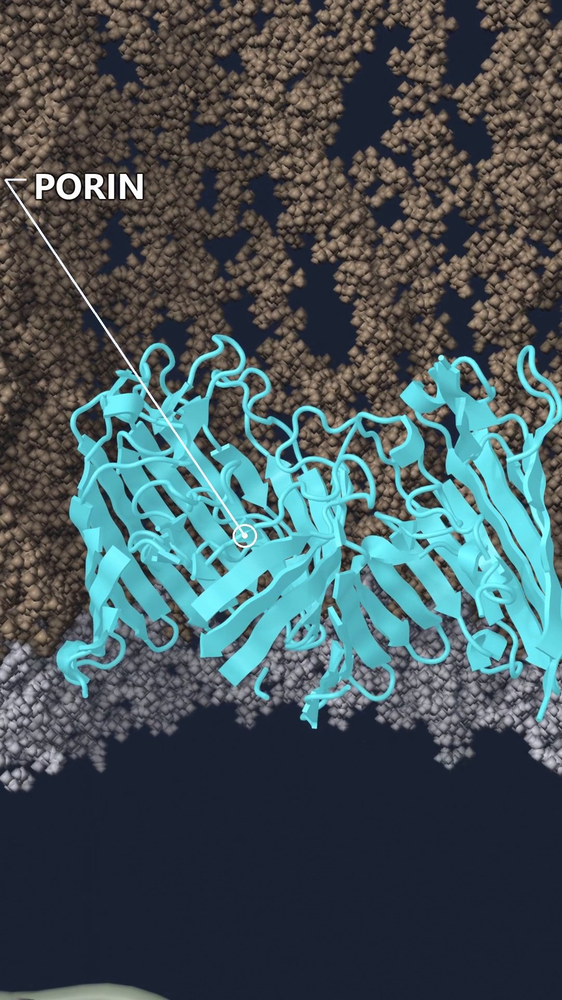
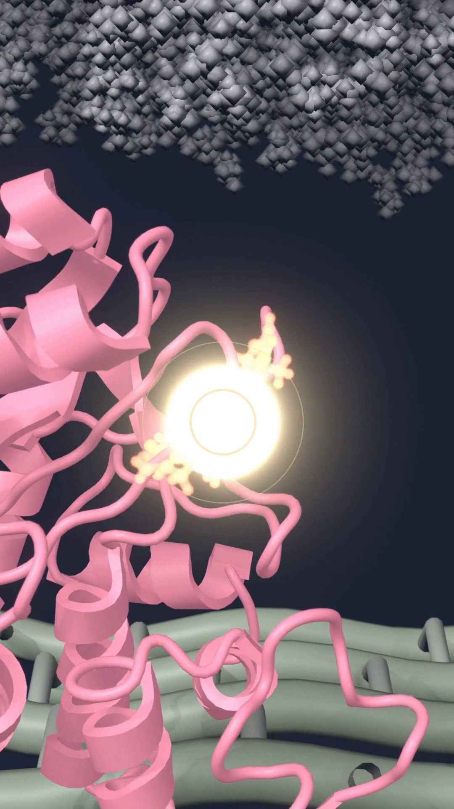

::: {.paper-cover}
{fig-alt="Three frames from the Short: the Gram-negative envelope, the porin, and the drug in the beta-lactamase active site"}
:::

I put the first episode on YouTube. It is about sixty seconds. It follows one beta-lactam, ceftazidime, from outside a Gram-negative cell to the point where a beta-lactamase opens its ring.



The film is [Inside a Gram-Negative Bacterium: How a Beta-Lactam Gets In and Gets Destroyed](https://youtube.com/shorts/kJKye8xqjRg). How the scene was built is a [separate note](../shorts-pipeline/).

## The wall is the story

A beta-lactam does not have to cross a Gram-positive wall in the same way. In a Gram-negative cell the drug meets an outer membrane first. The outer face of that membrane is lipopolysaccharide. Small hydrophilic drugs do not slip through that leaflet. They need a protein channel.

If a drawing sends the drug straight through the lipids, the drawing is teaching the wrong mechanism. The Short is built so the drug has to find a porin.

{fig-alt="Vertical cross-section of a Gram-negative envelope with each layer in a different colour"}

From the outside inward, the frame has five things that matter for this drug:

- Lipopolysaccharide on the outer leaflet.
- OmpF, a porin trimer, as the way in.
- The periplasm, with TEM-1 beta-lactamase loose in it.
- A peptidoglycan mesh. This is the only stylized object. Peptidoglycan does not have one atomic structure I can import.
- The inner membrane, with PBP1b embedded in it. That protein is the real target. AcrB, the efflux pump, sits in the same membrane. This episode does not follow the pump.

## The way in

Ceftazidime is small and polar. In *E. coli* the usual door for a molecule like this is a porin such as OmpF. The trimer in the film is PDB [3POX](https://www.rcsb.org/structure/3POX), placed in a lipopolysaccharide membrane that was built as a bilayer, not drawn as a flat band.

{fig-alt="Close view of a cyan porin under a brown lipopolysaccharide layer, with a line to the word PORIN"}

Loss of porins is its own resistance mechanism. This episode does not show that case. The porin is open, and the drug gets through. The failure happens one layer deeper.

## Where the drug dies

Once the drug is in the periplasm it is close to two proteins that want it for different reasons. PBP1b would bind it and stop cell-wall crosslinking. TEM-1 can bind it and open the four-membered ring. An opened beta-lactam no longer acylates the penicillin-binding protein.

The enzyme in the film is TEM-1 from PDB [1XPB](https://www.rcsb.org/structure/1XPB). The target it never reaches is PBP1b from PDB [3VMA](https://www.rcsb.org/structure/3VMA).

{fig-alt="Pink beta-lactamase cartoon with a bright glow at the drug in the active site"}

The glow is a film device. The chemistry is not. Opening the ring is hydrolysis. That is the resistance mechanism this episode is about: an enzyme in the periplasm removes the drug before the target sees it.

## What I am not claiming

Two limits belong in the same paragraph as the mechanism.

Wild-type TEM-1 is a penicillinase. It hydrolyzes penicillins well and ceftazidime poorly. Third-generation cephalosporins were useful against TEM-1 producers for that reason. Extended-spectrum variants, and other class A enzymes such as KPC, are the ones that open ceftazidime at a useful rate. I still used ceftazidime and TEM-1, because those are the coordinates I had. The film shows the class of event. It does not show the kinetics of wild-type TEM-1 against this drug.

The opened-ring pose is also borrowed. I could not find a PDB entry of hydrolyzed ceftazidime in a class A active site. I superposed KPC-2 with hydrolyzed cefotaxime, PDB [5UJ3](https://www.rcsb.org/structure/5UJ3), onto TEM-1 using the active-site residues, and I moved the ligand across. The two cephalosporins share the ring that opens. The side chain is different, and at this camera distance that difference is hard to see. The approximation is still an approximation.

The motion of the proteins comes from short molecular dynamics, not from a simulation of the chemical step. Bond breaking is a transition I placed in the edit. The time on screen is not the time of the reaction.

## What the next episodes can change

The same envelope can carry a different ending. If no beta-lactamase is in the periplasm, the same drug can reach PBP1b. If a beta-lactamase inhibitor is present, the enzyme is occupied and the drug is not. If the porin is gone, the drug may never enter. If AcrB is working, drug that did enter can be thrown back out. The side-by-side film is [Two fates](../two-fates/). The first episode still stops at the enzyme.
