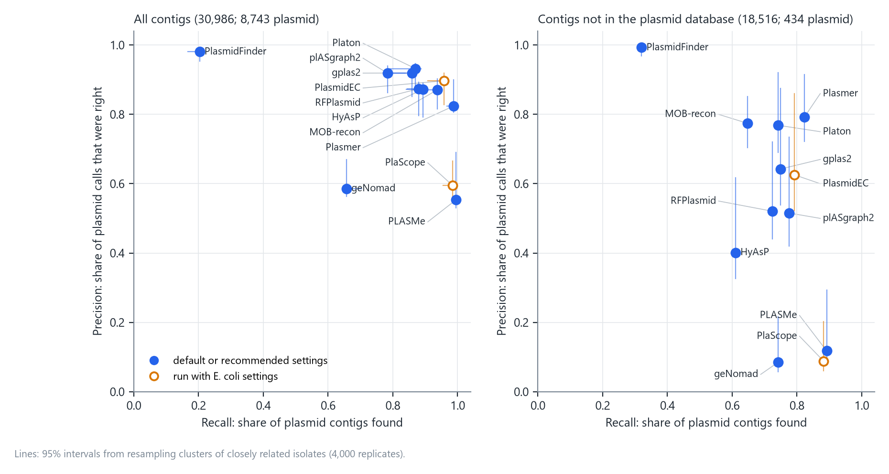
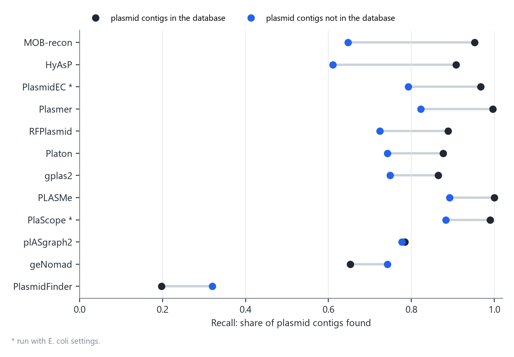
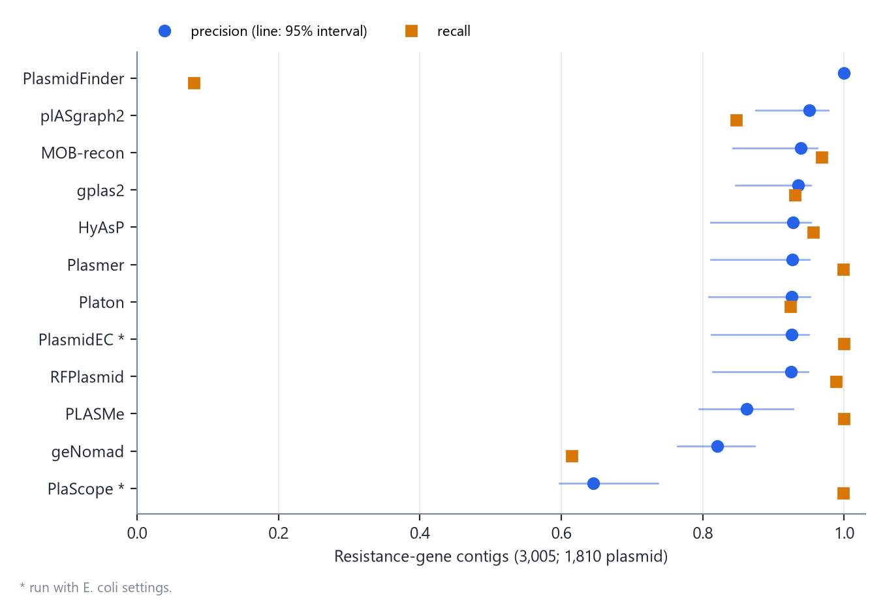
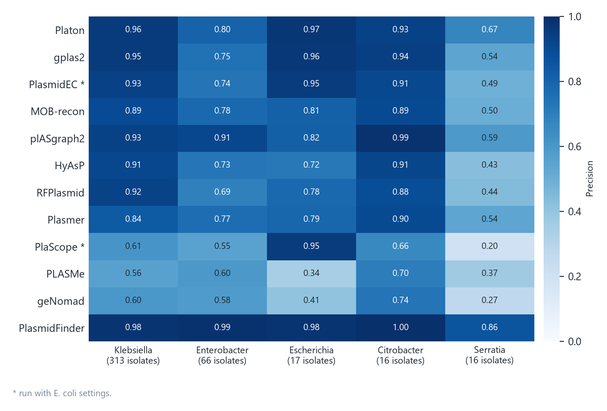
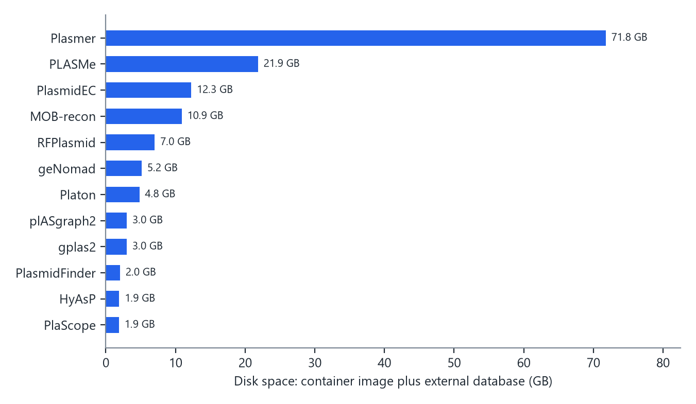

Most bacterial genomes in public databases are short-read assemblies. Whether a resistance gene in one of them sits on a plasmid or on the chromosome has to be guessed from its contig, and there are many tools that make that guess. I ran twelve of them on the same isolates and checked every call against an answer that no plasmid database had touched.

The short version: on contigs that resemble known plasmids, most tools do well. On contigs that do not, several of the most widely used tools call far more chromosome as plasmid than they find real plasmid. On contigs that carry a resistance gene, eight tools are right in 92 to 95 of every 100 plasmid calls.

## The isolates and the answer key

The isolates are 432 carbapenem-resistant Enterobacterales from one New York City hospital, collected in 2009-2018 and sequenced with both Illumina and Oxford Nanopore by [Gomez-Simmonds et al.](https://doi.org/10.1101/gr.279355.124) (BioProject PRJNA1133668). Most are *Klebsiella* (313), followed by *Enterobacter* (66), *Escherichia coli* (17), *Citrobacter* (16) and *Serratia* (16).

Each tool saw only the Illumina assembly. The answer key came from a hybrid assembly of the same isolate, built from the long and short reads:

- the longest sequence, and any other sequence of at least 1 Mb, is chromosome;
- any other closed circular sequence is plasmid;
- any other sequence connected to the chromosome in the assembly graph is chromosome.

Each short-read contig of at least 1 kb was aligned to its own isolate's hybrid assembly and took the label of the sequence it matched, if the match was clear. Of 35,805 contigs, 30,986 got a label; 8,743 of them are plasmid. Contigs without a clear match were left out of every count. All tool calls were fixed before any long read was downloaded.

## Results

Precision is the share of a tool's plasmid calls that were right. Recall is the share of plasmid contigs it found.

{fig-alt="Two scatter plots of precision against recall for twelve tools"}

::: {.small}

:::

\* PlasmidEC and PlaScope were run with their *E. coli* settings, which do not suit a cohort that is mostly *Klebsiella*. Their numbers here are not a fair test of either tool. "Not in DB": contigs that do not match the plasmid database (next section). Figure 1 shows 95% intervals, from resampling clusters of closely related isolates; the [CSV](plasmid_classifier_benchmark.csv) lists them.

**On all contigs**, PlasmidFinder is almost always right when it calls plasmid (0.981) but finds only one plasmid contig in five, because it looks only for replicon genes. Platon, gplas2, MOB-recon, RFPlasmid, HyAsP and plASgraph2 sit close together, with precision of 0.87-0.93 and recall of 0.78-0.94. PLASMe and Plasmer find nearly everything but pay for it in false calls: PLASMe called 7,025 chromosomal contigs plasmid.

## Contigs the database has never seen

I measured how well each contig is represented in a public plasmid database (the PLSDB-derived set distributed with PLASMe, 33,125 plasmids). A contig counted as in the database if at least 95% of it matched a database plasmid at 99% identity or more. By this measure, 18,516 contigs were not in the database. Only 434 of them are plasmid; the rest are chromosome.

This is where the tools come apart. Apart from PlasmidFinder, precision on these contigs ranged from 0.085 to 0.792. geNomad, PlaScope and PLASMe made 3,466, 3,963 and 2,894 false plasmid calls here, against fewer than 450 real plasmid contigs. For a gene on one of these contigs, a plasmid call from those three tools is wrong far more often than it is right.

Some of this drop is arithmetic: precision falls when positives are rare, and only 2.3% of these contigs are plasmid. But that is also the situation a user faces with a novel contig, so it is the number that matters in practice.

Recall drops too, for ten of the twelve tools:

{fig-alt="Dot plot of recall for each tool, in and out of the plasmid database"}

The two exceptions are geNomad and PlasmidFinder, which found a larger share of the plasmids that are not in the database than of those that are.

The database used here is one of several, and none of the plasmids in it is longer than 350 kb. So "not in the database" means not well represented in this one database. It is not a measure of true novelty.

## Contigs that carry a resistance gene

For most users the question is narrower: is this resistance gene on a plasmid? I annotated resistance genes with AMRFinderPlus v4.2.7 (database 2026-08-07.1) and counted a contig if it carried at least one core AMR determinant other than an efflux gene. There were 3,005 such contigs, and 1,810 of them (60%) are plasmid.

{fig-alt="Dot plot of precision and recall for each tool on resistance-gene contigs"}

::: {.small}

:::

Here the tools look better. Eight of them had precision between 0.925 and 0.951, and Plasmer, PlasmidEC, PLASMe, RFPlasmid and MOB-recon each found 96.8% or more of the plasmid-borne resistance contigs. PlaScope still made 993 false plasmid calls, and geNomad missed 698 of the 1,810 plasmid contigs.

Part of the gain is the same arithmetic as before, in the other direction: 60% of these contigs are plasmid, against 28% of all contigs, so a plasmid call is more likely to be right. Even the best tools here called 79-146 of the 1,195 chromosomal resistance-gene contigs plasmid. Chromosomal copies are not rare even for genes usually thought of as plasmid genes: of the 383 labeled contigs carrying *bla*~KPC~, 14 are chromosomal.

## By genus

{fig-alt="Heatmap of precision for each tool in Klebsiella, Enterobacter, Escherichia, Citrobacter and Serratia"}

Precision was lowest in *Serratia* for eleven of the twelve tools. The *Escherichia*, *Citrobacter* and *Serratia* groups each have only 16-17 isolates, so their numbers are rough.

## Disk space

{fig-alt="Bar chart of disk space per tool"}

Running all twelve takes about 146 GB, and Plasmer alone takes about half of that. Several of the best-balanced tools here (Platon, gplas2, HyAsP, plASgraph2) need 5 GB or less.

## What about combining them?

I also fitted a model that combines the twelve calls ([preprint](https://doi.org/10.21203/rs.3.rs-11651433/v1)). Against a plain majority vote of the same twelve tools, it traded recall for precision: it made 431 false plasmid calls and missed 713 plasmid contigs, where the vote made 852 and missed 307. The difference in F1 was close to zero (-0.002; 95% CI -0.011 to 0.009). On contigs absent from the database it made 6 false plasmid calls where the vote made 128. If you already run several of these tools, a majority vote is a reasonable baseline before reaching for anything fitted.

## Tools, versions and settings

Each tool ran in a pinned container with a pinned database, with the same settings for every isolate. Contigs a tool left undecided, or that it failed on, count as not plasmid in its recall; they do not affect its precision.

::: {.small}

:::

gplas2 starts from PlasmidEC's *E. coli* predictions, so it shares part of that mismatch.

## Limits

- One hospital, and the isolates are closely related: the largest cluster holds 66% of them. Results in other settings may differ.
- Contigs whose label was unclear (about one in seven) were left out, and they may be harder than the rest.
- Every tool was run once, with one version and one database. Newer versions or other settings may do better.
- PlasmidEC and PlaScope were run with *E. coli* settings (see above).

## Data

- Per-tool numbers behind this page: [plasmid_classifier_benchmark.csv](plasmid_classifier_benchmark.csv)
- Assemblies, labels and every tool call: [figshare, doi:10.6084/m9.figshare.34021401](https://doi.org/10.6084/m9.figshare.34021401)
- Native output of all twelve tools: [Harvard Dataverse, doi:10.7910/DVN/Q5JNX9](https://doi.org/10.7910/DVN/Q5JNX9)
- Analysis code: [figshare, doi:10.6084/m9.figshare.34063578](https://doi.org/10.6084/m9.figshare.34063578)
- Full methods: [Research Square, doi:10.21203/rs.3.rs-11651433/v1](https://doi.org/10.21203/rs.3.rs-11651433/v1)
