::: {.paper-cover}
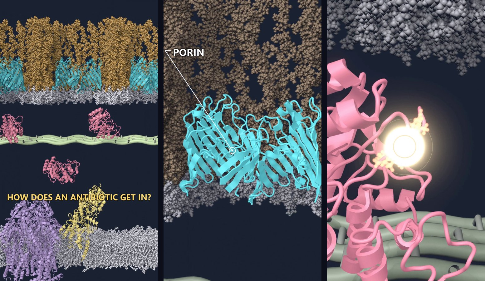{fig-alt="Three frames from the Short: the whole Gram-negative envelope in cross-section, the OmpF porin with a pointer label, and ceftazidime being hydrolyzed inside TEM-1 beta-lactamase"}
:::

The first episode of a short-video series on how antibiotics enter, and fail inside, a Gram-negative bacterium is now on YouTube. Every object in it is a real structure, and every motion of the proteins comes from a molecular dynamics simulation. This post describes how it was built, what the pipeline looks like, and what I would do differently.



Watch it on YouTube: [Inside a Gram-Negative Bacterium: How a Beta-Lactam Gets In and Gets Destroyed](https://youtube.com/shorts/kJKye8xqjRg). The series playlist is [here](https://www.youtube.com/playlist?list=PLbsoyL1U-sWc).

## Why build it this way

Most short science animations are drawn. That is fine for a cartoon of a cell, but for antibiotics the geometry is the story: a beta-lactam has to cross an outer membrane that is covered in lipopolysaccharide, find a porin, survive the periplasm, and reach a penicillin-binding protein. If the drawing puts the drug straight through the membrane, the video is teaching something false.

So the rule for the series was simple. Proteins come from the Protein Data Bank, membranes come from a physically built lipid bilayer, the drug is the real molecule, and the only stylized element is the peptidoglycan mesh, which has no single atomic structure to import. Labels and camera work can be as cinematic as needed, but nothing in the frame is invented.

## The pipeline at a glance

1. Collect structures and build membranes (PDB, OPM, MemProtMD, CHARMM-GUI).
2. Run molecular dynamics so the membrane and the enzyme move (GROMACS on a GPU under WSL).
3. Assemble a reusable base scene in Blender with Molecular Nodes.
4. Script the shots: a camera journey, labels anchored to the objects, a drug path with a docking and hydrolysis event.
5. Render, overlay the pointers in 2D, cut, add music and a sound effect (ffmpeg).

Everything is scripted. The base scene and the shots are Python files run against Blender in background mode, so a change to a label or a camera move is a one-line edit and a 20-minute re-render, not an afternoon in the viewport.

## Step 1: structures

The envelope needs seven kinds of object. Each came from a different place.

| Component | Source | Notes |
|---|---|---|
| OmpF porin trimer | PDB 3POX, oriented by OPM | The way in for small hydrophilic drugs |
| Outer membrane with LPS | CHARMM-GUI Membrane Builder | 45 E. coli LPS (lipid A, R1 core, O1 antigen) on the outer leaflet; PE/PG/cardiolipin inside |
| TEM-1 beta-lactamase | PDB 1XPB | The classic plasmid enzyme |
| PBP1b | PDB 3VMA, oriented by OPM | The real target of the drug |
| AcrB efflux pump in a bilayer | MemProtMD 4DX5 | Crystallization DARPins removed |
| Inner membrane | MemProtMD bilayer, re-used | Patched so the pump appears once |
| Ceftazidime | RCSB ideal coordinates (CAZ) | Bonds kept for ball-and-stick |

The hydrolyzed product pose came from a different enzyme. There is no PDB entry with hydrolyzed ceftazidime in a class A beta-lactamase, so I superposed KPC-2 with hydrolyzed cefotaxime (5UJ3) onto the TEM-1 frame using the active-site Ambler residues and transferred the ligand. The two cephalosporins share the core that opens, and the side-chain difference is invisible at this scale, but the limitation is real and worth stating.

## Step 2: molecular dynamics

Two systems were simulated with GROMACS 2026 and the CHARMM36m force field.

The first was TEM-1 in water, 10 nanoseconds, so that the enzyme breathes on screen instead of sitting still. The second was the OmpF porin in the LPS outer membrane, about 229,000 atoms, taken through the six CHARMM-GUI equilibration stages and a 5-nanosecond production run.

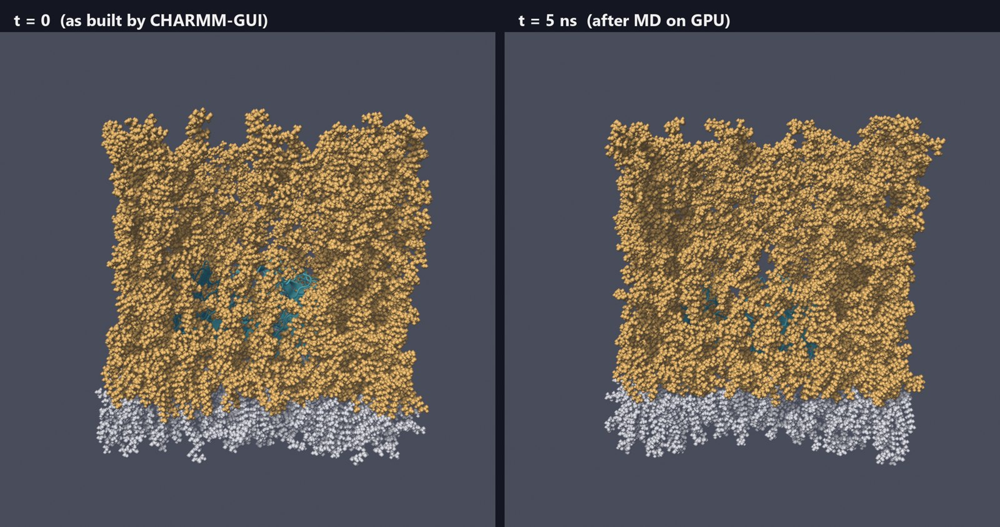{fig-alt="Side-by-side renders of the outer membrane before and after molecular dynamics"}

An honest note on that second system. Five nanoseconds is nowhere near enough to relax a brush of O-antigen sugars; the before and after frames look similar. The simulation is there to make the membrane alive in the video and to give the proteins realistic local motion, not to make any claim about LPS dynamics.

One practical lesson: the conda-forge GROMACS build uses OpenCL, which cannot see an NVIDIA card under WSL. The CUDA build (`nompi_cuda`) runs the same simulation about ten times faster. The first production run started on the CPU at 41 ns/day and finished on the GPU at 384 ns/day after a checkpoint restart.

## Step 3: the base scene

The scene is a cross-section. A geometry-nodes clip removes the half of every membrane nearest the camera, so the porin channel, the periplasm and the inner membrane are visible in profile. The outer membrane is tiled three times along its periodic box vector, which gives three porins at realistic density without any seam.

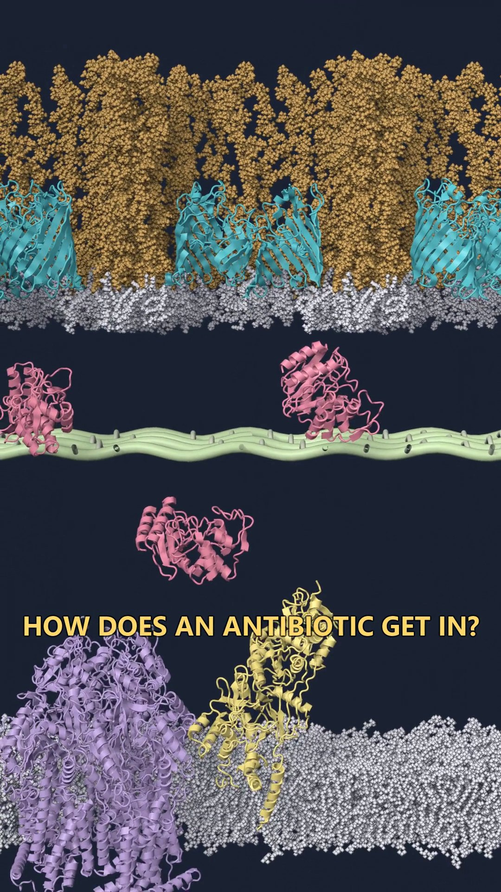{fig-alt="Vertical frame showing all three layers of the Gram-negative envelope"}

Dimensions were checked against the literature before anything was animated: a 21 nm periplasm, peptidoglycan 6 nm under the outer membrane, a 13.6 nm AcrB that matches the OPM reference, and a 5 nm bilayer. A pleasant coincidence: the distance from the top of AcrB to the bottom of the outer membrane is 13.9 nm, which is the length of TolC, so the full efflux assembly can be added later without moving anything.

The molecular dynamics trajectories are wired to the Blender timeline through Molecular Nodes, with the three TEM-1 copies offset in time so they do not move in sync.

## Step 4: directing it

The first cut had the right science and the wrong film grammar: a static camera, flat layers, and captions at the bottom of the frame. Reviewing it frame by frame against the kind of Shorts that actually hold attention produced a list of 26 problems. They fell into three groups, and each got its own pass.

**Pointing instead of writing.** Labels moved out of the 3D scene entirely. The render exports the screen position of each anchor per frame, and a small 2D pass draws a pulsing ring on the object, a leader line that draws itself toward the label, and a single word. Text can never end up behind geometry this way. While a component is introduced, everything else is dimmed and desaturated.

{fig-alt="Frame with the OmpF porin highlighted and a leader line to the word PORIN"}

**One continuous camera journey.** Instead of seven jump cuts, the camera starts on the LPS surface with a question, pulls out to the whole envelope, and descends layer by layer with gentle arcs and changes of height. Dwell times vary between 3.5 and 5.5 seconds. The peptidoglycan is seen from above so that it reads as a mesh.

**A real climax.** The moment the beta-lactam ring opens is the point of the episode, and in the first cut it was almost invisible. It now gets a macro shot, a slower transformation, a flash at the bond, expanding rings drawn in 2D, a short synthesized impact sound, and a dip in the music.

{fig-alt="Close frame of TEM-1 with the drug glowing in the active site"}

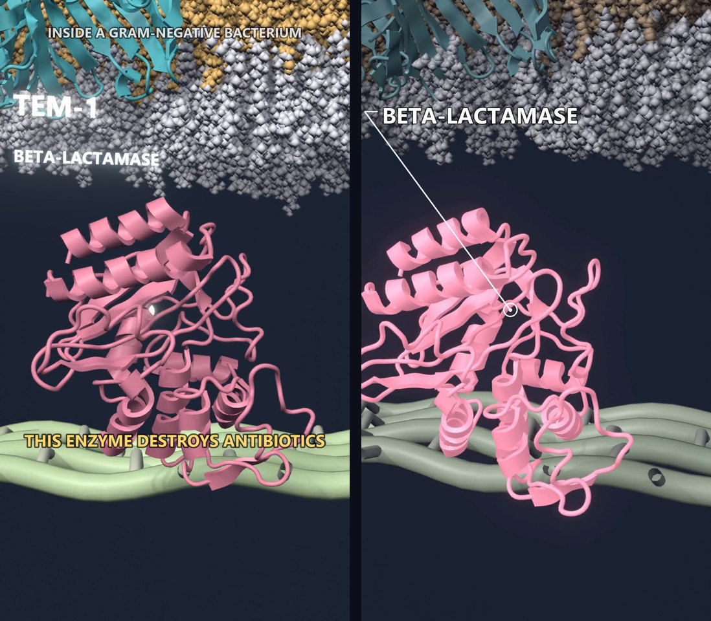{fig-alt="Side-by-side comparison of the same enzyme shot in the first and final versions"}

## Step 5: the edit

The two rendered parts (the tour and the drug's entry) are joined with a crossfade, the title and gold headlines are burned in by ffmpeg, and the music track is normalized to the YouTube loudness target with fades at both ends. A one-second cross-fade at the join and a 0.6-second duck under the impact sound are the only two audio events. Full-resolution rendering of the whole film takes about 20 minutes on a laptop GPU with EEVEE, so iterating was cheap once the scene existed.

## Process gallery

The frames below are the actual intermediate outputs, in the order they were produced. They are not polished; they are what the pipeline looked like while it was being built.

::: {.panel-tabset}

### Structures and scene

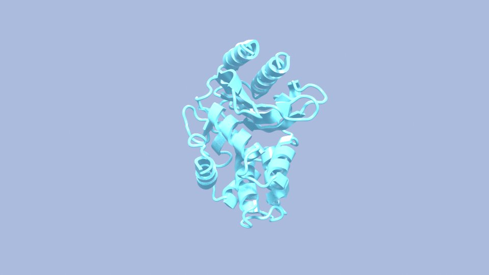{fig-alt="Early render of TEM-1 as a teal cartoon"}

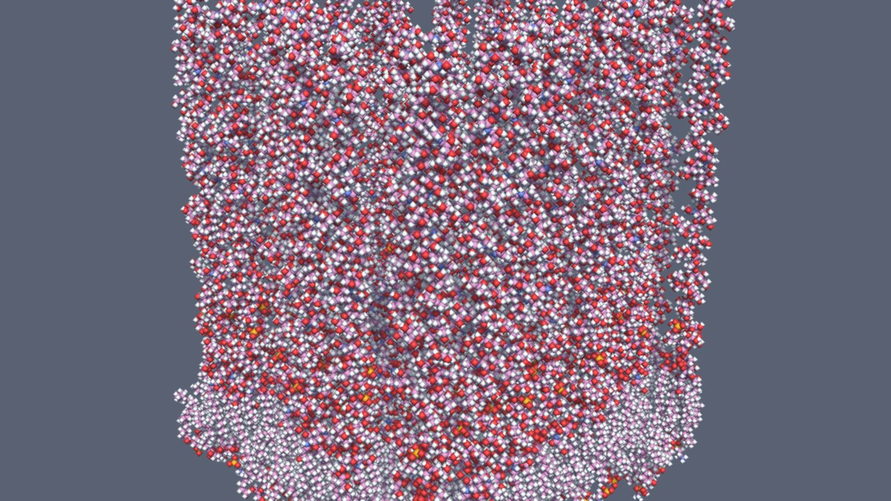{fig-alt="Raw sphere render of the OmpF and LPS membrane"}

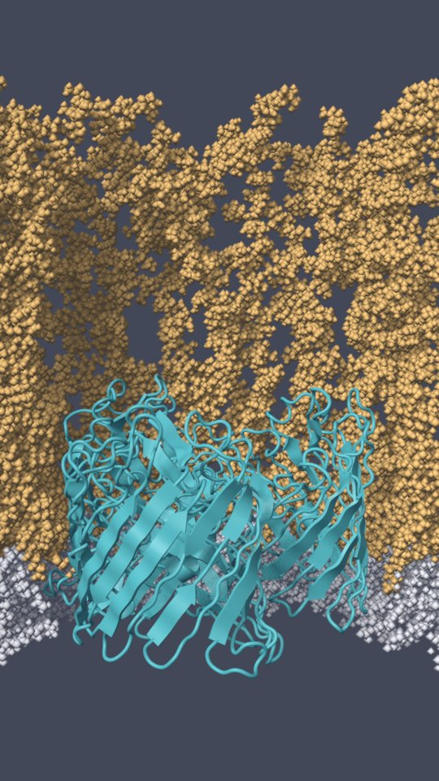{fig-alt="Cross-section of the outer membrane with the porin visible"}

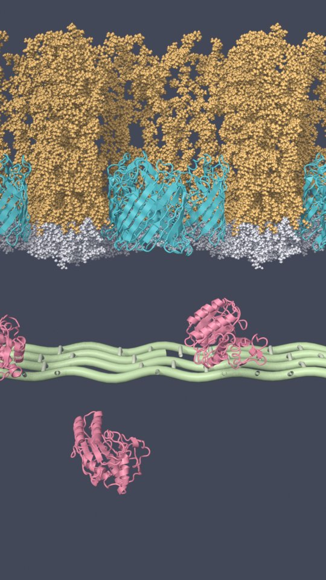{fig-alt="Outer membrane with peptidoglycan and enzymes below"}

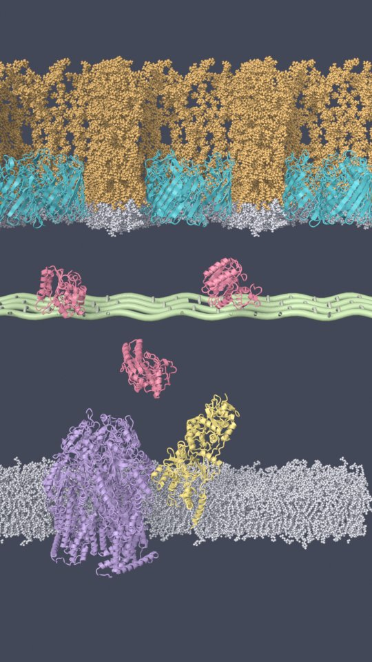{fig-alt="Complete envelope cross-section"}

### Animation

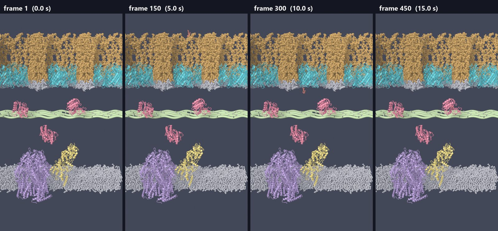{fig-alt="Four wide frames with the drug as a small glowing point"}

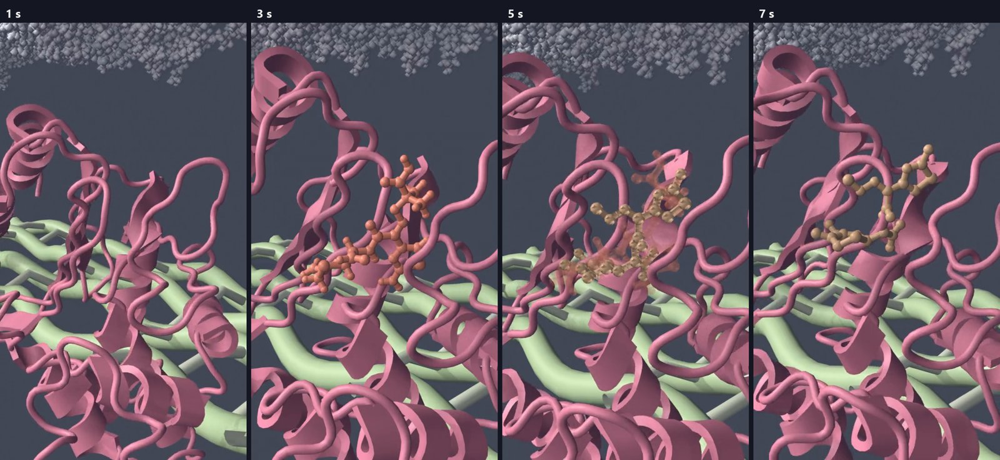{fig-alt="Four close frames of TEM-1 with the drug"}

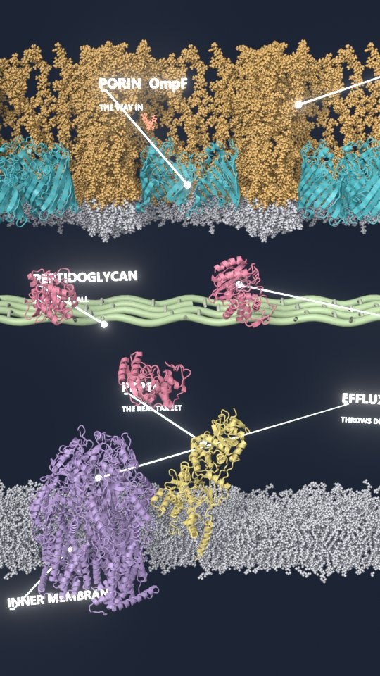{fig-alt="Wide frame with 3D labels on every component"}

### Checking

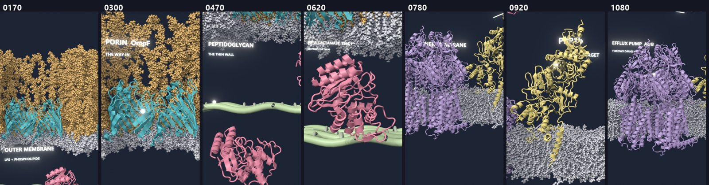{fig-alt="Seven small frames from the tour used to validate framing"}

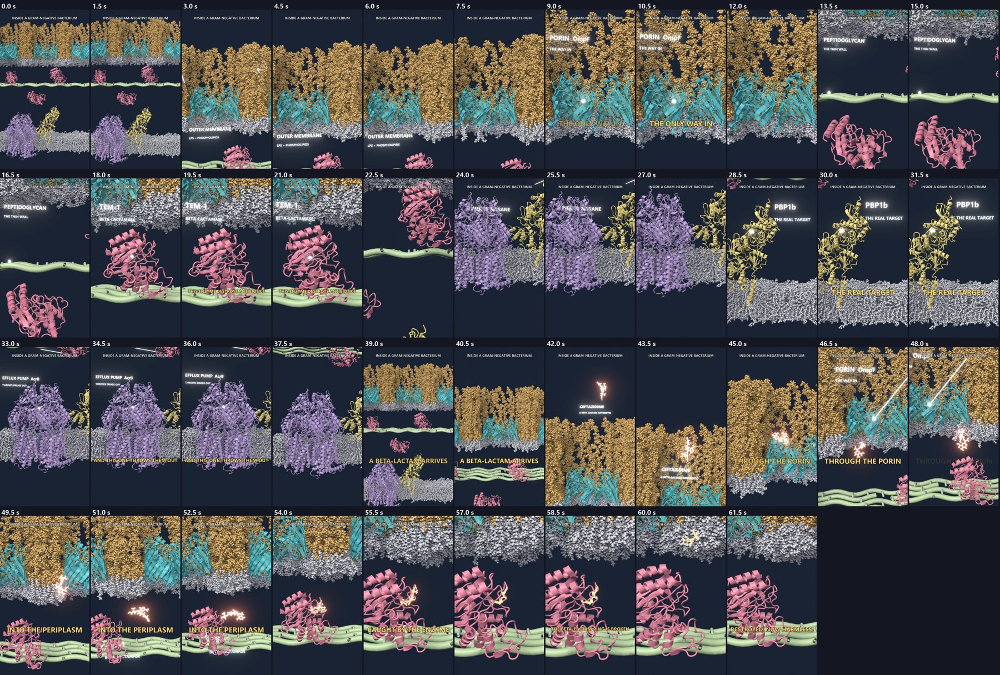{fig-alt="Grid of 42 frames from the first cut"}

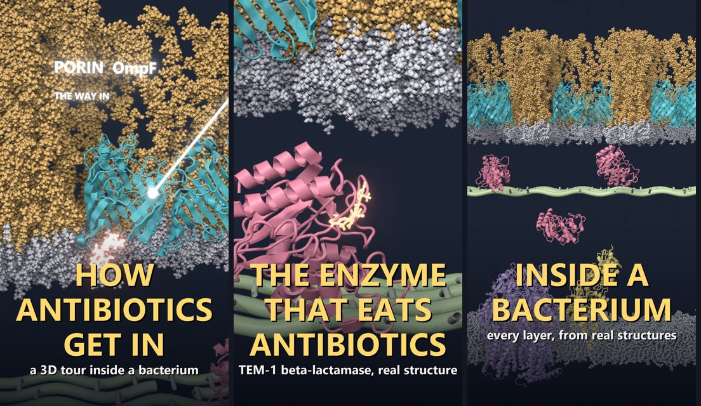{fig-alt="Three vertical thumbnail designs"}

:::

## What I would do differently

- Validate every shot with still frames before rendering the sequence. Almost every wasted render in this project came from skipping that step.
- Place label anchors on geometry that is actually visible from the camera, not on the cut plane. With an elevated camera the two can differ by several nanometers on screen.
- Decide early that the climax deserves a third of the effort. It is the frame people remember.
- Keep the lipids as spheres for now, but switch the large proteins to a surface representation for the close shots in the next episode. Ribbons get busy at 10 nm.

## Reuse

The scene is a kit. The next episodes change only the drug path, the binding pose and the labels: a beta-lactam reaching PBP1b when no beta-lactamase is present, avibactam protecting ceftazidime, a porin loss, and the efflux pump throwing the drug out. The scripts, structures and simulation inputs live in the [site repository](https://github.com/piranfar/piranfar.github.io/tree/main/youtube-shorts); the large renders and trajectories are not committed.

::: {.callout-note}
### Key points

- Every protein, membrane and drug in the video is a real structure; only the peptidoglycan mesh is stylized.
- Protein motion comes from GROMACS simulations run on a GPU under WSL.
- The scene is scripted end to end in Blender with Molecular Nodes, so edits are cheap.
- Labels are drawn in 2D from exported anchor positions, so they never hide behind the scene.
- The hydrolyzed product pose is borrowed from KPC-2 with cefotaxime, a stated approximation.
:::
