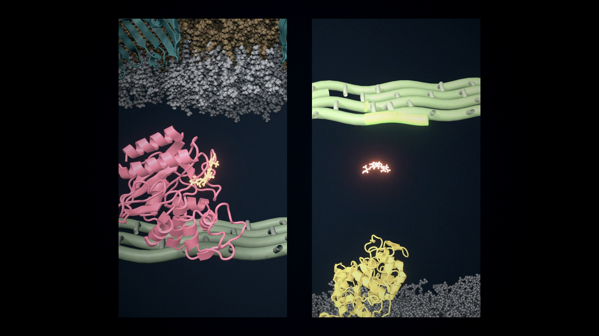
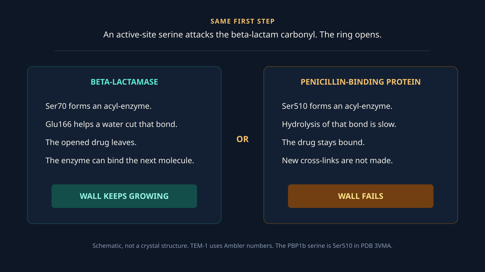
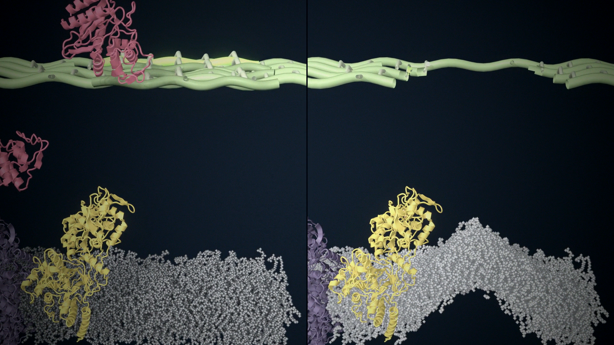
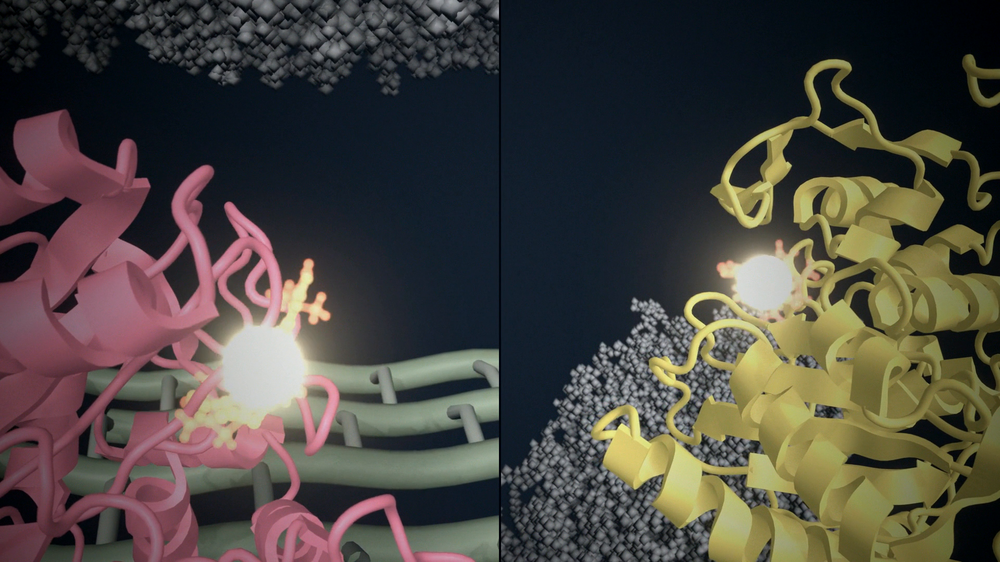

::: {.paper-cover}
{fig-alt="Split frame. Left, a cell with a beta-lactamase and an intact wall. Right, a cell without the enzyme and a broken wall."}
:::

The film runs for about two minutes. Two Gram-negative cells sit side by side. The drug, the door, and the first part of the path are the same. One extra protein changes the ending.



The film is [Two Fates: One Enzyme Decides Whether an Antibiotic Works](https://youtu.be/gU2kKaWwa2s). The left-hand cell is the [first Short](../beta-lactam-gets-in/). The right-hand cell is also its own Short, [Hitting the wall](https://youtube.com/shorts/ufXzk6dhlX8).

## One protein, not a stronger cell

Resistance in this film is not a thicker wall and not a cell that ignores the drug. It is a protein in the periplasm that removes the drug before the target sees it.

The left cell carries TEM-1, a class A serine beta-lactamase. The right cell does not. Both still have the target, penicillin-binding protein 1b (PBP1b). PBP1b extends the glycan strands of peptidoglycan and cross-links their peptide stems. A beta-lactam is built to occupy that cross-linking site.

## The shared path

Ceftazidime is a third-generation cephalosporin. It is small and charged, so it does not cross the lipopolysaccharide leaflet of the outer membrane. In *E. coli* the usual door is a porin such as OmpF. In the film both cells use the same porin, and the pictures match until the drug is in the periplasm.

{fig-alt="Two vertical frames. Left shows TEM-1 with the drug. Right shows the drug above PBP1b and an intact peptidoglycan mesh."}

From the outside inward, both cells have the same envelope:

- Lipopolysaccharide on the outer leaflet.
- OmpF, PDB [3POX](https://www.rcsb.org/structure/3POX), as the channel.
- A thin peptidoglycan mesh in the periplasm. This mesh is stylized. Peptidoglycan has no single atomic structure to import.
- An inner membrane with PBP1b, PDB [3VMA](https://www.rcsb.org/structure/3VMA), and one AcrB pump from MemProtMD [4DX5](https://www.rcsb.org/structure/4DX5). The pump is in the scene. This film does not follow it.

## The same reaction, then a branch

TEM-1 and the transpeptidase of PBP1b are both serine enzymes. The first chemical step is the same. The serine oxygen attacks the carbonyl of the beta-lactam. The four-membered ring opens, and the drug becomes an ester on that serine. That species is the acyl-enzyme.

The enzymes differ in what happens next. A beta-lactamase is built to cut the ester quickly and let the product go. A penicillin-binding protein is not. Its acyl-enzyme lasts long enough to take the active site out of use.

{fig-alt="Two-column diagram. Left, beta-lactamase, Ser70, product leaves, wall keeps growing. Right, penicillin-binding protein, Ser510, drug stays bound, wall fails."}

On TEM-1 the nucleophile is Ser70, in Ambler numbering. Glu166 helps a water attack the ester. The opened drug leaves, and the serine is free. The enzyme can bind another molecule. One copy can therefore clear many drug molecules. That is why a single periplasmic enzyme can protect the cell.

On PBP1b the nucleophile is Ser510. It sits in the conserved SxxK motif. The other two motifs used to place the drug, SxN and KTG, are Ser572 and Lys698 in this structure. Hydrolysis of the PBP ester is slow. While the serine is occupied, new peptide cross-links are not made.

For many cephalosporins, opening the ring is followed by loss of the group at C3. In ceftazidime that group is a pyridinium. The film does not resolve that step. It shows the ring opening, and then either release or a stable adduct.

## Two endings for the wall

On the left, the drug never stays on PBP1b. The transpeptidase keeps working. New strands are cross-linked, and the wall continues.

On the right, PBP1b is locked. A growing cell keeps remodeling its wall. If new cross-links stop while that remodeling continues, the mesh opens and turgor pushes the inner membrane out. The film draws that gap and that bulge. It does not simulate turgor or name a particular autolysin.

{fig-alt="Split view of two cells. The left wall is continuous. The right wall is broken and the membrane below it sags."}

{fig-alt="Pink TEM-1 and yellow PBP1b, each with a bright drug in the active site."}

## What was measured, and what was placed

OmpF in the lipopolysaccharide membrane comes from a short molecular dynamics run, about 5 ns after the CHARMM-GUI equilibration. Five nanoseconds does not relax the O-antigen. The run supplies local motion, not a claim about membrane dynamics. TEM-1 motion comes from 10 ns in water. Bond breaking is not in either simulation. I placed that transition in the edit. The time on screen is not the time of the reaction.

Two ligand poses are transferred.

The opened drug on TEM-1 is not from a TEM-1 crystal. I superposed KPC-2 with hydrolyzed cefotaxime, PDB [5UJ3](https://www.rcsb.org/structure/5UJ3), onto the TEM-1 active site and moved the ligand across. Wild-type TEM-1 hydrolyzes penicillins well and ceftazidime poorly. Extended-spectrum variants, and other class A enzymes such as KPC, are the ones that open ceftazidime at a useful rate. The film shows the class of event with the coordinates I had. It does not show the kinetics of wild-type TEM-1 against this drug. The same limit is spelled out in the [first episode](../beta-lactam-gets-in/).

The covalent drug on PBP1b is cefotaxime from PDB [2C5W](https://www.rcsb.org/structure/2C5W), a pneumococcal PBP1a acyl-enzyme. I superposed the three motifs onto *E. coli* PBP1b and kept the opened ligand. The intact molecule that flies in is ceftazidime, placed on that same site by matching its principal axes to the bound ligand. Cefotaxime and ceftazidime share the ring that opens. Their side chains differ. At this camera distance the difference is easy to miss, so it belongs in the text.

## What this film leaves out

The porin is open. AcrB is idle. No inhibitor is present. A later film can close the porin, add TolC above AcrB, or put avibactam on the beta-lactamase so the drug reaches PBP1b even when the enzyme is there. This one stops at the branch: release, or a locked target.
