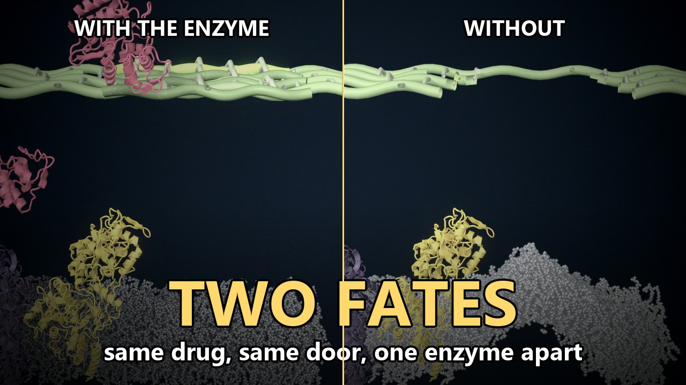
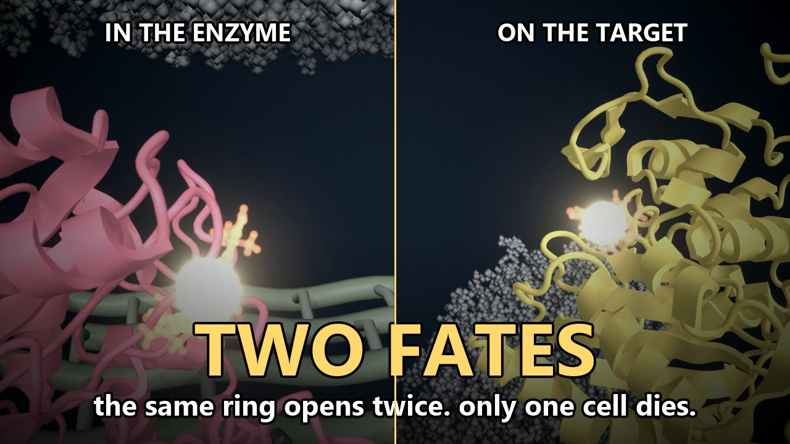

::: {.paper-cover}
{fig-alt="Split frame. Left, a cell with a beta-lactamase and an intact wall. Right, a cell without the enzyme and a broken wall."}
:::

The new film is about two minutes. It puts two Gram-negative cells next to each other. The drug, the door, and the first part of the path are the same. Then one enzyme changes the ending.



The film is [Two Fates: One Enzyme Decides Whether an Antibiotic Works](https://youtu.be/gU2kKaWwa2s). The left-hand cell is the [first Short](../beta-lactam-gets-in/). The right-hand cell is also its own Short, [Beta-lactams hit the wall](https://youtube.com/shorts/ufXzk6dhlX8).

## Same door

Ceftazidime enters both cells through an OmpF porin. For the first stretch the two pictures match, frame for frame. The drug is a third-generation cephalosporin. Nothing about the molecule changes between the two sides.

What changes is what is waiting in the periplasm.

## Where they part

On the left, TEM-1 is in the periplasm. It binds the drug and the beta-lactam ring opens. The broken drug is released. The wall keeps growing.

On the right, that enzyme is absent. The drug reaches PBP1b, the protein that is building the wall. The ring opens on the active-site serine and the drug stays bound. Wall synthesis stops. A gap opens in the mesh, and the inner membrane pushes through.

{fig-alt="Split close-up. Pink beta-lactamase on the left, yellow penicillin-binding protein on the right, each with the drug lit in the active site."}

The chemistry is the same reaction. The difference is whether the protein lets the product go.

## What is drawn, and what is not

OmpF and the lipopolysaccharide membrane come from a short molecular dynamics run. TEM-1 motion comes from a 10 ns run in water. PBP1b is PDB [3VMA](https://www.rcsb.org/structure/3VMA). AcrB is in the inner membrane from MemProtMD [4DX5](https://www.rcsb.org/structure/4DX5), and this film does not follow the pump.

Two poses are transferred, not crystallized in these exact proteins. The opened cephalosporin in TEM-1 comes from PDB [5UJ3](https://www.rcsb.org/structure/5UJ3), KPC-2 with hydrolyzed cefotaxime, placed on the TEM-1 active site. The drug on PBP1b comes from PDB [2C5W](https://www.rcsb.org/structure/2C5W), a pneumococcal PBP with cefotaxime, placed on the conserved active-site motifs of *E. coli* PBP1b. Wild-type TEM-1 hydrolyzes ceftazidime poorly. The film shows the class of event, not the kinetics of this exact pair. The longer note on that limit is in the [first episode](../beta-lactam-gets-in/).

The peptidoglycan mesh has no single atomic structure, so it is stylized. So is the lysis. Protein motion is from the simulations. The bond breaking is a transition I placed in the edit.
