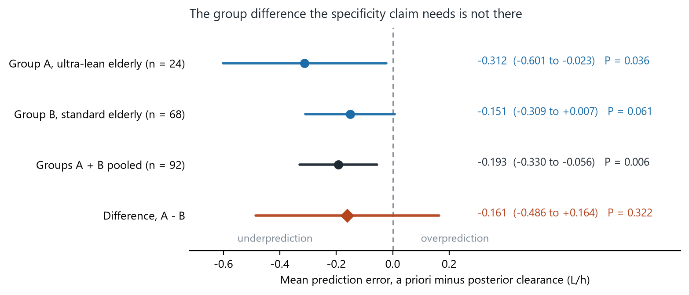
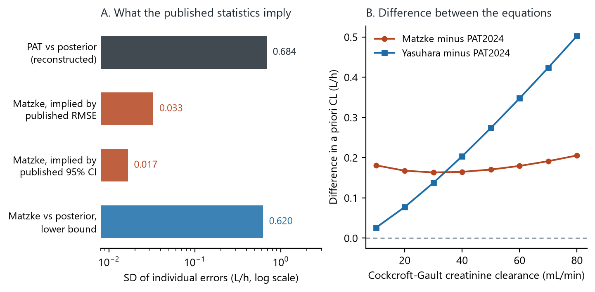

A short communication in *Therapeutic Drug Monitoring* reported that a vancomycin population model underpredicts clearance in ultra-lean elderly patients but not in standard elderly patients, and concluded that the bias is specific to the ultra-lean phenotype [@nojima]. I rebuilt the statistics from the numbers the paper prints. The underprediction is real and it is larger than the paper's own framing suggests, because it holds across both elderly groups together. What the data do not support is that it singles out the ultra-lean.

The short version: the difference between the two elderly groups is -0.161 L/h with a 95% CI of -0.486 to +0.164 and P = 0.32, so the specificity claim rests on a significant result in one group beside a non-significant result in another, which is not a group difference [@altman]. Pooling the two elderly groups gives a mean error of -0.193 L/h (P = 0.006). Separately, the higher weight-normalized dose in the ultra-lean group, offered in the paper as a sign that clinicians compensated for the model, is what creatinine-clearance-based dosing produces by itself.

I wrote this up as a Letter to the Editor. The journal sent it out for review and then declined it. The letter is reproduced in full below, the reviewer's assessment is quoted, and every number is in a CSV at the end.

## What the original study reported

Nojima evaluated the PAT2024 population pharmacokinetic model [@oda] against Bayesian posterior clearance in 116 patients, in three groups: ultra-lean elderly (group A, age 75 or over and BMI 18.5 kg/m² or below, n = 24), standard elderly (group B, age 75 or over and BMI above 18.5, n = 68), and younger controls (group C, n = 24) [@nojima].

The headline result is a mean prediction error (a priori minus posterior clearance) of -0.312 L/h in group A with P = 0.038, against -0.151 L/h in group B with P = 0.051. From this the paper concludes that underprediction is specific to the ultra-lean phenotype, and it offers two supporting arguments: that the higher dose per kilogram in group A shows clinicians compensating for conservative predictions, and that two older models [@matzke] biased in the opposite direction, which points to an overcorrection mechanism.

## How I checked it

I had no access to individual data. Everything here is reconstructed from the summary statistics the article prints: mean error, root mean squared error, sample size, and the group means and standard deviations of Table 1.

The reconstruction recovers the standard deviation of the individual prediction errors from the mean error, the RMSE and n. It is not an assumption-free step, but it has a check built in: it has to reproduce the P values the article reports. It does. My reconstructed P values are 0.036 for group A and 0.061 for group B, against the published 0.038 and 0.051 from Wilcoxon tests. Agreement that close means the reconstructed standard deviations are close to the real ones, and everything downstream rests on them.

## The specificity claim does not survive a direct comparison



{fig-alt="Forest plot of mean prediction error for group A, group B, the two pooled, and the A minus B difference, which crosses zero"}

How to read it: the first two rows are the two elderly groups as the article analyzed them, one significant and one not. The third row pools them. The fourth row is the comparison the specificity claim actually needs, and its interval runs from -0.486 to +0.164 L/h.

Three things follow.

The difference between the groups is not estimated with any useful precision. A two-sided test at 5% has about 17% power for a difference of the size observed, and the smallest difference this design could detect with 80% power is 0.450 L/h, larger than either group's mean error. The study was never in a position to establish specificity, whatever the within-group tests showed.

The article's own secondary analyses point the same way. It reports no difference in prediction error across body-weight strata in the whole cohort (P = 0.913) and no monotonic association with BMI among the elderly (rho = 0.117, P = 0.268). Those two results sit uneasily beside a claim that the bias belongs to a low-BMI phenotype.

Pooling the two elderly groups gives a mean error of -0.193 L/h with a 95% CI of -0.330 to -0.056 and P = 0.006, which is a firmer result than either group alone. This is the part worth emphasizing: the reanalysis does not weaken the clinical message, it widens it. If the model underpredicts in patients aged 75 and over as a group, then early concentration monitoring is indicated for more patients than the ultra-lean, not fewer.

## The dosing pattern is not evidence of clinical compensation

The paper argues that group A received a higher weight-normalized dose (22.4 against 19.1 mg/kg/d) and that this shows the bias is "not merely an artifact of dosing feedback", with clinical judgment partially compensating for conservative predictions.

Cockcroft-Gault creatinine clearance per kilogram depends on age, sex and serum creatinine, but not on weight. With the article's Table 1 means it is 1.221 times higher in group A than in group B. The PAT a priori clearance per kilogram is 1.218 times higher. The observed dose per kilogram is 1.173 times higher. A dosing rule that targets an AUC from creatinine clearance produces exactly this pattern with no clinical judgment involved.

{fig-alt="Scatter of dose per kg against clearance per kg for three groups, with iso-AUC diagonals and a shaded target band"}

How to read it: a group sitting on the same diagonal as another received the same AUC per unit of clearance. Dividing mean daily dose by mean a priori clearance gives 514 mg·h/L in group A and 528 in group B, so at the group level the doses show no departure from creatinine-clearance-based dosing. Against the posterior clearance the same doses give 416 mg·h/L in group A and 478 in group B, with group A near the lower edge of the target.

Two smaller points belong here. The A-versus-B P values the abstract gives for a priori clearance (P < 0.001) and dose per kilogram (P = 0.014) are the three-group Kruskal-Wallis values from Table 1, not two-group comparisons; other A-versus-B contrasts in the Results are reported differently (daily dose, P = 0.213). Welch tests from the published means and standard deviations give P = 0.25 and P = 0.12. And the evaluated PAT2024 equation was developed from 2022-2023 data [@oda] and released in January 2025, after the April 2018 to March 2024 study period, so it cannot have guided the initial doses. The circularity argument the paper builds on dosing feedback needs that timing stated.

## The comparison with older models does not hold together

The paper reports that the Matzke model had a mean error of +0.17 L/h with a 95% CI of 0.163 to 0.177 and an RMSE of 0.173, against the PAT model's -0.312, and reads the opposite sign as support for an overcorrection mechanism.

{fig-alt="Left, horizontal bars of implied error standard deviation on a log axis. Right, two curves of equation difference against creatinine clearance."}

How to read it: a mean error of 0.17 with that confidence interval and that RMSE implies individual errors with a standard deviation of about 0.03 L/h, which is 20 times tighter than the 0.684 L/h implied for the PAT model in the same patients. No clearance model predicts individual patients that precisely. What does behave that way is the difference between two deterministic equations evaluated on the same patient: panel B shows the Matzke and PAT2024 equations differ by a nearly constant 0.16 to 0.21 L/h across creatinine clearances of 10 to 80 mL/min.

So the older models were most likely compared against the PAT a priori clearance, not against the Bayesian posterior. A distribution-free bound makes the same point without assuming a distribution: if those errors were measured against the posterior, their standard deviation could not be below about 0.62 L/h, while the published statistics allow at most about 0.18.

If that is what happened, then mean errors add, and the Matzke and Yasuhara mean errors against the posterior would be about -0.14 and -0.10 L/h. All three models would then be biased in the same direction, and the opposite-direction contrast that supports the overcorrection mechanism would not exist.

This is the one point the journal's reviewer agreed with.

## What this challenges, and what it does not

This matters more than any single number, so I will be exact about it.

**Not challenged.** The primary measurement stands. In group A the a priori estimates were lower than the posterior estimates, and my reconstruction reproduces the article's own P value. I am not claiming the data are wrong, the analysis was mishandled, or the result is an artifact. I also deliberately did not claim that the published confidence interval for group A is wrong: it is centered on -0.265 rather than on the mean error, which is consistent with a rank-based interval, and a sensitivity analysis using the article's interval instead of mine leaves the between-group comparison non-significant either way (P = 0.25).

**Challenged, and in my view not sustainable.** Two inferences, both stated by the paper and neither following from its data:

1. *That the bias is specific to the ultra-lean phenotype.* This requires a between-group comparison that was never made, and when made it gives P = 0.32 with 17% power. The article's own weight-strata and BMI analyses agree.
2. *That clinical judgment compensated for the model.* The dose ratio of 1.17 is slightly below the creatinine-clearance ratio of 1.22, so the doses are what the rule alone predicts.

**Flagged, but not settled without the authors.** Three items that need an answer rather than an argument: how bias was computed for the older models; how many concentrations each patient contributed, since one trough is enough for inclusion and shrinkage toward the prior attenuates the very difference being measured [@savic]; and whether the software's serum-creatinine rounding or its muscle-mass-loss option was used, both of which lower predicted clearance and would do so more often in the ultra-lean group.

The honest summary is that this is a reframing, not a refutation. It replaces a narrow claim with a broader and better-supported one, and it removes two interpretive layers the data do not carry.

## What the journal decided

*Therapeutic Drug Monitoring* assigned the letter number TDM26-340-LE on 19 October 2026, sent it for external review, and rejected it on 10 November 2026 on priority grounds. The reviewer's assessment is worth quoting, because it is a fair statement of the limits of this kind of reanalysis.

On the between-group comparison:

> "Although this may be correct based on the statistical reconstruction presented in the letter, this finding does not invalidate or detract from the primary findings of the original study. [...] Whether the magnitude of this bias differs significantly between groups is a separate question and does not invalidate the original analysis or its primary findings."

On the model comparison:

> "The concern raised in the letter regarding the comparison of the PAT model [...] with two previously published models (Matzke and Yasuhara) is justified. The original publication does not clearly describe how bias was calculated or reported [...] This distinction is important for interpreting the comparative model performance results. Nevertheless, this comparison was secondary to the primary analysis of the original publication. While the methodological concern is valid, addressing it through a Letter to the Editor may be disproportionate, and direct correspondence with the original authors may have been sufficient."

I accept the second point as a reasonable editorial judgment and have no quarrel with it. I disagree with the first only in emphasis: the specificity of the bias to the ultra-lean phenotype is in the paper's title, abstract and conclusion, so a reader who takes the paper at face value will act on a claim the data do not support. Whether that is worth a letter is the editor's call, not mine.

I am publishing it here because the recalculations are reusable whatever the editorial outcome, and because a reader of the original paper may want to see them.

## The letter, as submitted

The text below is version 6, the version submitted on 16 October 2026, unchanged except that the figure is split into the two shown above and the reference numbers are replaced by links.

> **Is Vancomycin Clearance Underprediction Specific to Ultra-lean Elderly Patients?**
>
> To the Editor:
>
> I read with interest the short communication by Nojima [@nojima], which reported that the Practical AUC-guided therapeutic drug monitoring (PAT) model [@oda] underpredicted vancomycin clearance (CL) in ultra-lean elderly patients (group A; mean error [ME], -0.312 L/h; P = 0.038) but not in standard elderly patients (group B; ME, -0.151 L/h; P = 0.051), a result the article describes as "a tendency toward underestimation." The question matters for patients with very low muscle mass. However, two of the paper's inferences are not supported by the reported data, and several methods need clarification.
>
> First, the Abstract suggests that "clinical judgment may have partially compensated for conservative model predictions," and the Limitations section uses the higher weight-normalized dose in group A (22.4 versus 19.1 mg/kg/d) to argue that the bias is "not merely an artifact of dosing feedback." AUC-targeted dosing from creatinine clearance alone would produce this pattern. Cockcroft-Gault creatinine clearance per kilogram depends on age, sex, and serum creatinine but not on weight; with the Table 1 means, it is 1.22 times higher in group A, and the PAT-predicted CL per kilogram is also 1.22 times higher (0.044 versus 0.036 L/h/kg), against an observed dose ratio of 1.17. Mean daily dose divided by mean a priori CL was 514 mg·h/L in group A and 528 mg·h/L in group B, so, at the group level, the doses show no departure from creatinine clearance-based dosing. The P values given for these A-versus-B contrasts (P < 0.001 for a priori CL; P = 0.014 for dose per kilogram) equal the 3-group Kruskal-Wallis values of Table 1, unlike other A-versus-B comparisons in the Results (eg, daily dose, P = 0.213); Welch tests from the published means and SDs give P = 0.25 and P = 0.12. Moreover, the PAT2024 equation evaluated in the article was developed from 2022-2023 data [@oda] and released in PAT version 4.0 in January 2025, after the study period (April 2018 to March 2024). Which model guided initial doses? If it was not the evaluated one, the statements that doses were chosen with the evaluated predictions, and the circularity argument built on them, need correction. Against the mean posterior CL, the same doses give about 416 mg·h/L in group A, near the lower limit of the 400-600 mg·h/L target.
>
> Second, the conclusion that the bias is specific to the ultra-lean phenotype rests on a significant result in group A and a nonsignificant one in group B, without a direct comparison of the 2 estimates [@altman]. I reconstructed the standard deviation of the prediction errors from the reported ME, root mean squared error (RMSE), and sample size; the reconstruction reproduces the reported P values closely (0.036 and 0.061 versus 0.038 and 0.051). The difference in ME between groups A and B is -0.161 L/h (95% CI, -0.486 to 0.164; P = 0.32). Secondary analyses agree: prediction error did not differ across body-weight strata in the whole cohort (P = 0.913), and the article found "no significant monotonic association" with body mass index (BMI) in the elderly (rho = 0.117; P = 0.268). Pooling groups A and B gives an ME of -0.193 L/h (95% CI, -0.330 to -0.056; P = 0.006). The data therefore show a modest negative ME in patients aged 75 years or older as a group; a larger bias in ultra-lean patients is neither shown nor excluded, and a direct comparison of the individual errors would settle it.
>
> Third, posterior CL was estimated with the same model from trough concentrations, and inclusion required only 1 measurable concentration. Shrinkage toward the prior [@savic] attenuates prior-posterior differences, and different sampling between groups could create or mask a group difference. Could the author report the number of concentrations per patient in each group? The reference for the Yasuhara and Matzke comparison also needs stating. For the Matzke model, an ME of 0.17 L/h with a 95% CI of 0.163 to 0.177 L/h and an RMSE of 0.173 L/h imply individual errors with a standard deviation of about 0.03 L/h, against 0.68 L/h for the PAT model. This matches the nearly constant difference between the Matzke and PAT2024 equations (0.16 to 0.21 L/h for creatinine clearances of 10 to 80 mL/min). Were the alternative models compared with the PAT a priori CL rather than the posterior? Because mean errors add, their MEs against the posterior would then be about -0.14 L/h (Matzke) and -0.10 L/h (Yasuhara): all 3 models would have negative mean errors, and the opposite-direction bias cited in support of an overcorrection mechanism would not hold.
>
> Finally, PAT calculates creatinine clearance with the Cockcroft-Gault equation from actual body weight, and its guidance permits rounding serum creatinine below 0.6 mg/dL up to 0.6 mg/dL in selected patients, including those aged 75 years or older or with a BMI below 16 kg/m². The article states that albumin and cystatin C were not entered; a muscle-mass-loss option also changes the PAT CL equation and, by default, rounds serum creatinine internally. Was either option used, and in how many patients per group, when doses were chosen or a priori CL was calculated? Rounding lowers predicted CL in both elderly groups, more often in group A, and could account for part of the pooled underprediction.
>
> The advice to monitor concentrations early in ultra-lean elderly patients is sensible. On the data reported, a priori PAT estimates were lower than posterior estimates in patients aged 75 years or older as a whole, but the data show neither that this difference is larger in ultra-lean patients nor that clinical judgment compensated for the model.

## Limits

Everything here is reconstructed from published summary statistics. I did not see a single patient record. The reconstruction of the error standard deviations is validated only by its agreement with the published P values, which is close but not proof. The group-level dose-to-clearance ratios use ratios of means, not means of ratios, and the two are not identical when the within-group distributions are skewed; the intervals in the CSV come from the rounding of the published means and do not cover that difference. The distribution-free bound on the Matzke error standard deviation is conditional on the default PAT2024 equation as stated in the article. None of the questions in the last section can be settled without data only the authors hold.

## Data and code

- Every recomputed quantity with its interval: [vancomycin_ultra_lean_reanalysis.csv](vancomycin_ultra_lean_reanalysis.csv)
- The article reanalyzed: Nojima, *Ther Drug Monit* 2026;48(5):698-702, [doi:10.1097/FTD.0000000000001481](https://doi.org/10.1097/FTD.0000000000001481)
- The evaluated model: Oda et al., *J Infect Chemother* 2024;30(12):1244-1251, [doi:10.1016/j.jiac.2024.05.014](https://doi.org/10.1016/j.jiac.2024.05.014)

The figures and the CSV are generated by one script from one frozen results file, with the input checked by hash and the group sizes asserted against the article's Table 1 before anything is drawn.

## References

::: {#refs}
:::
