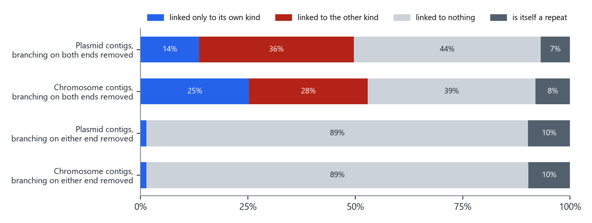
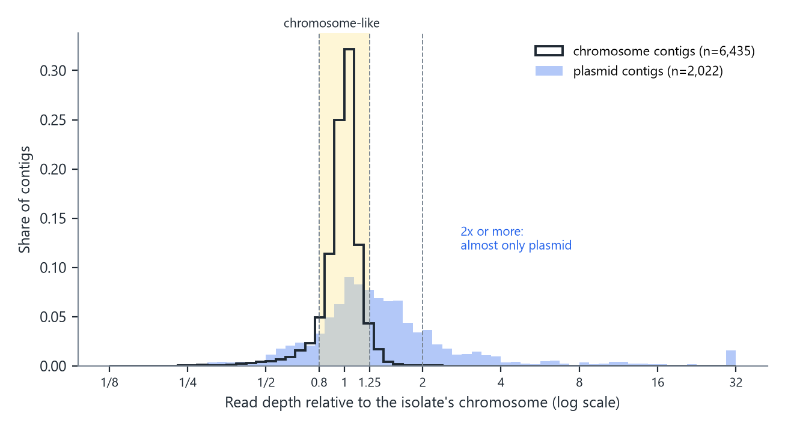
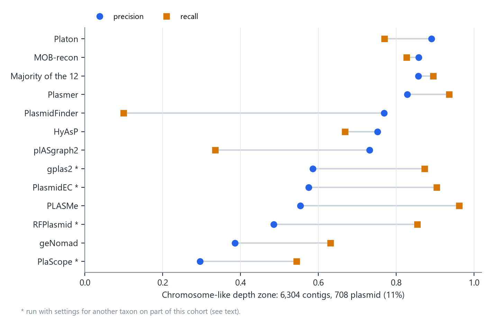
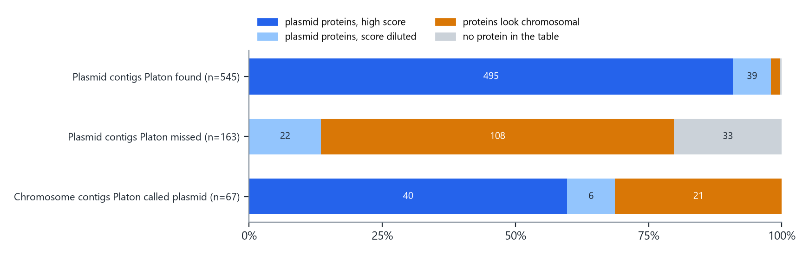
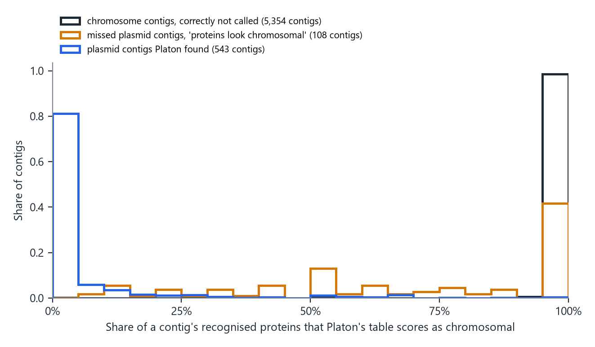

In a [benchmark of twelve plasmid classifiers](../plasmid-classifier-benchmark/) I measured how often they are wrong. This note asks why. In this data, the answer is mostly not that the tools are poorly built. The largest group of errors sits where a short-read assembly does not carry the information that would settle the question.

I split the problem along three lines a classifier could use: how a contig is connected in the assembly graph, how deep it is covered by reads, and which proteins it carries. Each one was measured against the true location of every contig.

## The genomes and the answer key

The data are 150 public genomes, 25 from each of six taxa: *Citrobacter* spp., *Enterobacter* spp., *Enterococcus faecalis*, *Enterococcus faecium*, *Klebsiella pneumoniae* and *Serratia* spp. Each has Illumina reads and a complete genome deposited for the same isolate. The isolates were chosen to be distinct from one another.

I assembled the Illumina reads with Unicycler and aligned every contig to its own isolate's complete genome. A contig of at least 1 kb took the label of the replicon it matched (chromosome or plasmid, as named in the deposited genome) when the match was clear. That gives **9,371 labeled contigs: 2,241 plasmid and 7,130 chromosome**. The twelve classifiers are the same versions, settings and databases as in the [benchmark](../plasmid-classifier-benchmark/).

## Step 1: the assembly graph does not join a plasmid's pieces

A plasmid of 100 kb usually breaks into many contigs. A natural idea is to find one piece that is clearly plasmid and follow the assembly graph to its neighbors. To test whether that can work, I removed the repeat segments from each graph (the segments where the graph branches) and asked what each labeled contig is still connected to.

{fig-alt="Stacked bars of graph context for plasmid and chromosome contigs under two repeat definitions"}

**How to read it.** Each bar is one set of contigs, split by what remains attached to them. Blue means the contig is still linked only to contigs of its own kind (the useful case). Red means it is linked to a contig of the other kind. Gray means it is linked to nothing.

With a lenient definition (a segment is a repeat only if the graph branches on both of its ends), 36% of plasmid contigs are still linked to chromosome contigs, and only 14% are linked to plasmid contigs alone: the graph leads in the wrong direction more often than the right one. With the strict definition (branching on either end), the wrong links disappear, and so do almost all the right ones: **89% of plasmid contigs are linked to nothing**. Only 1% keep a link to another plasmid contig.

This is how short-read assemblers work. They stop a contig exactly where it runs into a repeat, such as an insertion sequence, and the same repeats occur on the plasmid and on the chromosome. Every path from one plasmid piece to the next passes through one of them. Following the graph cannot separate the two without information the reads do not carry.

## Step 2: read depth decides one direction

A plasmid can be present in more copies per cell than the chromosome, so its contigs collect more reads. I divided each contig's read depth by the depth of the isolate's chromosome.

{fig-alt="Histograms of relative read depth for plasmid and chromosome contigs on a log scale"}

**How to read it.** The black outline is chromosome contigs and the blue fill is plasmid contigs, each scaled to sum to one. The horizontal axis is relative depth on a log scale: 1 means the same depth as the chromosome, 2 means twice as deep.

Chromosome contigs sit in a narrow peak: 87% fall between 0.8 and 1.25 times, and only 0.1% reach twice the chromosome's depth. Plasmid contigs spread out: 21% are at twice the chromosome's depth or more. So depth is close to proof in one direction: **a contig twice as deep as the chromosome is almost certainly plasmid**. In the other direction it says nothing. 35% of plasmid contigs have the depth of the chromosome, as expected for plasmids kept at about one copy per cell.

## Five zones of difficulty

Graph shape and depth together split the contigs into zones that need no classifier to define.

::: {.small}

:::

**How to read it.** "Share plasmid" is the fraction of contigs in the zone that are plasmid. It is also the precision you would get by calling every contig in that zone plasmid, with no tool at all. The last column counts the contigs on which more of the twelve tools were wrong than right.

- **Circular, or twice the chromosome's depth.** 433 of 441 contigs are plasmid. Calling all of them plasmid is right 98% of the time, yet the majority of the twelve tools was wrong on 32 of them. Any pipeline can take these for free.
- **Chromosome-like depth.** This is where the problem lives: 6,304 contigs, of which only 11% are plasmid, and 166 of the 400 contigs the tools get wrong by majority.
- **Repeat segments.** 914 contigs that are themselves repeats. They account for another 94 majority errors.

## The tools in the hard zone

{fig-alt="Dot plot of precision and recall per tool in the chromosome-like depth zone"}

::: {.small}

:::

**How to read it.** Each row is one tool. The blue circle is precision, the share of its plasmid calls that were right. The orange square is recall, the share of plasmid contigs it found. Rows are ordered by precision.

\* PlaScope and PlasmidEC were run with their *E. coli* settings, gplas2 starts from PlasmidEC's calls, and RFPlasmid used its Enterobacteriaceae model on every isolate, including the 50 *Enterococcus*. This cohort spans six taxa, so these four rows are not a fair test of those tools.

Platon was the most precise tool in this zone: 89% of its plasmid calls were right, and it found 77% of the plasmid contigs. MOB-recon and the majority vote came next. Because Platon is the most precise tool here, and because its method can be reproduced exactly, the rest of this note uses it as a lens: when the most precise tool misses, why does it miss?

## How Platon decides

[Platon](https://doi.org/10.1099/mgen.0.000398) predicts the genes on each contig and looks each protein up in a table built from complete reference genomes. A protein matches if it is at least 90% identical over at least 80% of both lengths. Each table entry carries a score: positive if that protein is found mostly on plasmids, negative if mostly on chromosomes. A contig's score is the sum of its proteins' scores divided by the number of proteins it carries. Proteins that match nothing count as zero.

I repeated this lookup for all 620,476 proteins in the 150 assemblies, with Platon's own program versions and database (version 1.5.0), and checked it against Platon's real calls. Of Platon's 1,867 plasmid calls, 1,642 have a reproduced score of 0.7 or more, its strictest cut-off. None of its 7,504 chromosome calls do.

## Why Platon misses plasmid contigs

In the chromosome-like depth zone, Platon missed 163 of 708 plasmid contigs. I sorted each one by what its proteins showed.

{fig-alt="Stacked bars of the reasons behind Platon's calls in the chromosome-like depth zone"}

::: {.small}

:::

**How to read it.** Each bar is one group of contigs. Dark blue means the contig carries proteins the table scores as plasmid and its score is high. Light blue means plasmid proteins are there but the average stays low. Orange means the proteins the table recognizes score as chromosomal. Gray means none of its proteins is in the table.

Two-thirds of the misses are orange. These plasmid contigs carry proteins that Platon recognizes, almost perfectly (median identity 99.3%), and the table says those proteins usually live on chromosomes.

{fig-alt="Histograms of the share of chromosome-leaning proteins per contig for three groups"}

**How to read it.** Each contig counts once. A contig at 100% carries only proteins the table calls chromosomal; one at 0% carries only plasmid-leaning proteins.

Chromosome contigs sit at 100%, and the plasmid contigs Platon found sit near 0%. The missed plasmid contigs sit mostly with the chromosome: their median is 75%, and 83 of the 108 have at least half of their recognized proteins scored as chromosomal. Among the most common of these proteins are lactose operon genes (beta-galactosidase, lactose permease, the lactose repressor), ABC transporters, a cell division protein and transposases. Apart from the transposases, these are genes the table mostly sees on chromosomes, sitting in these isolates on a plasmid.

I tested one way the isolate itself could give this away: if the plasmid carries a copy of a chromosomal gene, the same gene might appear twice in the assembly. It does not, in most cases. Only 4.6% of these contigs have half or more of their proteins on a second contig of the same isolate, against 4.5% of chromosome contigs that Platon called plasmid.

A protein that is 99% identical to one usually found on chromosomes does not say where it sits now. Only its surroundings can, and in a short-read assembly the surroundings are what is missing: depth looks like the chromosome's (this is the chromosome-like zone) and the graph link to the rest of the plasmid runs through a repeat (Step 1).

The gray part, 33 contigs whose proteins are not in the table at all, is the only part a better reader of proteins could reach. Even that is not a clean signal: 175 chromosome contigs in the same zone are also absent from the table. If all 33 were recovered, Platon's recall in this zone would rise from 0.770 to 0.816.

## One reference genome is probably wrong

While checking these contigs I found one isolate where the answer key itself looks wrong. The deposited genome of an *E. faecalis* isolate (BioSample SAMN39634310) has a 2.21 Mb chromosome and a 748 kb replicon labeled plasmid. Together they make about 2.96 Mb, the normal size of a whole *E. faecalis* genome, and the contigs from the "plasmid" carry chromosomal proteins at chromosomal depth. It is most likely part of the chromosome, and on those contigs Platon was right.

It is the only one of the 150 references with a short chromosome and a replicon this large; one *Citrobacter* genome has a 448 kb plasmid beside a normal 5.03 Mb chromosome. Without the *E. faecalis* isolate, Platon misses 152 plasmid contigs in the zone instead of 163, and 97 of them (64%) still carry proteins that look chromosomal. The conclusion does not depend on it.

## By taxon

::: {.small}

:::

**How to read it.** Each row is one taxon of 25 genomes. The third column counts plasmid contigs at chromosome-like depth; the last two split Platon's misses among them by the reason above.

The *K. pneumoniae* misses are almost all of one kind: 47 of 54 carry proteins that look chromosomal. *E. faecium* has the most plasmid contigs at chromosome-like depth, 287, and the largest group of misses with no protein in the table, 15 of 38.

## What this means for building a better tool

- **The easy fifth is already solved.** Circular contigs and contigs twice as deep as the chromosome are plasmid 98% of the time. A pipeline should take these without asking any classifier.
- **The graph cannot carry the label.** Nearly every plasmid contig is cut off by repeats, so methods that propagate a label along the graph hit the same wall.
- **In the hard zone, the limit is the data.** Two-thirds of the most precise tool's misses are plasmid contigs whose recognized proteins look chromosomal. A new model reading those proteins, at any depth of representation, reads the same proteins. The location is carried only by context that short reads do not provide.
- **For these contigs the honest answer is "unknown", or long reads.** A hybrid assembly resolves them directly; that is how the answer key here was built.

## Limits

- One collection of 150 genomes. The depth cut-offs (0.8, 1.25 and 2) were chosen while looking at these data, so the zone sizes need confirming in another cohort.
- The analysis of misses uses Platon's table as its lens. Other tools score proteins differently, and a gene the table scores as chromosomal may be common on plasmids in taxa the table under-represents.
- Labels come from genomes deposited by others. One is probably wrong (see above); others may be too. Contigs without a clear label were left out.
- The repeat definition is simple: a segment where the graph branches. A different definition changes the graph numbers, as the two bars in the first figure show.
- Four of the twelve tools were run with settings for another taxon on part of this cohort.

## Data

- Per-contig table behind every number here (zone, graph context, depth, the panel's verdict, Platon's call and score, and the reason for each miss): [plasmid_error_anatomy_P113.csv](plasmid_error_anatomy_P113.csv)
- Assemblies, assembly graphs, labels and the twelve tools' calls: [Zenodo, doi:10.5281/zenodo.22086357](https://doi.org/10.5281/zenodo.22086357)
- Platon: Schwengers O, et al. Microb Genom. 2020. [doi:10.1099/mgen.0.000398](https://doi.org/10.1099/mgen.0.000398)
- The twelve-tool benchmark on 432 clinical isolates: [Twelve Plasmid Classifiers on 432 Clinical Isolates](../plasmid-classifier-benchmark/)
